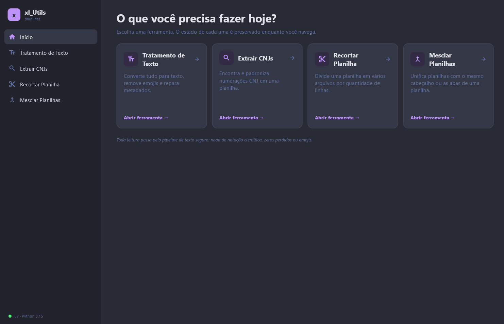
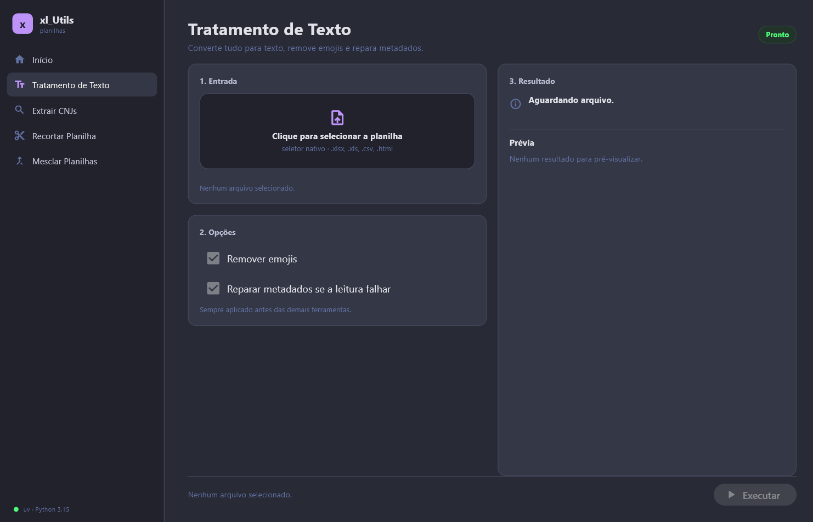

# Interface

**O que responde:** layout, navegação, componentes e tema. **O que não
responde:** regras de negócio (ver `architecture.md`) nem o porquê (ver
`../adr/0003-ui-sidebar-e-inicio.md`).

## Layout

Sidebar fixa de 260 px + área de conteúdo. A sidebar é um `Column` próprio, não
um `NavigationRail`: assim ícones, rótulos e o item ativo ficam alinhados de
forma consistente. Ela tem o logo, o item **Início** e as quatro ferramentas.
O conteúdo abre em uma das duas formas:

- **Início:** hub com cartões das ferramentas.
- **Ferramenta:** cabeçalho + duas colunas (entrada/opções e resultado) + barra
  de ação fixa, separada do corpo por 16 px. As duas colunas rolam na vertical
  sem barra visível; os cartões recortam o conteúdo e nunca invadem a barra de
  ação.

```text
┌──────────┬────────────────────────────────────────────┐
│ Início   │  Título da ferramenta          [status]   │
│ Texto    ├───────────────────┬────────────────────────┤
│ CNJ      │ 1. Entrada        │ 3. Resultado           │
│ Recortar │    dropzone       │    status + caminho    │
│ Mesclar  │ 2. Opções         │    log + prévia        │
│          ├───────────────────┴────────────────────────┤
│          │ [resumo]                    [Executar]     │
└──────────┴────────────────────────────────────────────┘
```

## Capturas





## Navegação e estado

- Trocar de ferramenta **mantém** o estado dela (arquivo, opções e resultado).
- Trocar o arquivo **reseta o resultado**; o valor das opções permanece.
- A página inicial é o hub; o item “Início” volta para ele.

## Componentes

| Componente | Responsabilidade |
|---|---|
| `sidebar` | Logo, Início e as quatro ferramentas, com item ativo destacado. |
| `file_input` | Dropzone clicável + seletor nativo, lista de arquivos, remover e resetar. |
| `sheet_selector` | Chips por aba, “Todas”/“Limpar” e contador “N de M”. |
| `options_panel` | Controles específicos; campos editáveis guardam o valor no `ToolState`. |
| `result_panel` | Status, caminho de saída, abrir pasta, log e prévia. |
| `preview_table` | Primeiras linhas do resultado, somente leitura. |
| `tool_layout` | Cabeçalho, cartões, barra de ação e estados. |

### Entrada de arquivos

O Flet 1.0 não expõe arrastar e soltar arquivos do sistema operacional. O
dropzone é uma área clicável que abre o `FilePicker` nativo; o texto "clique
para selecionar" substitui a promessa de drop. Todas as ferramentas aceitam
vários arquivos: depois do primeiro, o dropzone vira “Adicionar outro arquivo” e
a lista permite remover cada um.

### Seleção de abas

Abaixo da lista de arquivos, o card “1. Entrada” mostra chips com o nome de cada
aba. No lote, o padrão marca todas as abas de todos os arquivos; no merge, a
primeira de cada um. “Todas” e “Limpar” mudam tudo de uma vez e o contador
mostra “N de M”. Os chips quebram linha (`Row(wrap=True)`) e a seleção é
guardada por arquivo no `ToolState`. Se a listagem falhar, o seletor mostra o
erro do arquivo e a execução reporta a falha de leitura; sem nenhuma aba
marcada, a ferramenta não executa e pede uma seleção. Enquanto as abas são
lidas, aparece um spinner e o botão Executar fica desabilitado.

### Mesclagem

O merge usa a mesma seleção de abas, com a primeira aba de cada arquivo marcada
por padrão quando há vários. Em “2. Opções”, a seção **“Alinhamento de colunas”**
mostra um quadro de colunas de saída. Cada chip representa uma coluna de uma
aba e exibe `arquivo · aba`; arrastar um chip para outra coluna junta as duas
no mesmo destino, e arrastar para antes de outro chip muda a ordem. O **primeiro
chip de cada coluna define o cabeçalho** e recebe o ícone de alfinete.

Os botões “+ esq.” e “+ dir.” criam uma coluna vazia ao lado; “Nova coluna”
acrescenta uma no fim. Uma coluna vazia só aparece como área de destino e é
ignorada na execução. Colunas com o mesmo nome já nascem juntas; para separar
uma correspondência automática, crie uma coluna vazia e arraste um dos chips
para ela. Cada aba pode contribuir com no máximo uma coluna por saída. O quadro
é refeito quando os arquivos ou as abas mudam e o estado vive em
`ToolState.options`. A saída `Merge.xlsx` mostra `ORIGEM` como primeira coluna,
com arquivo, aba e linha.

## Início

O hub mostra quatro cartões em uma linha no desktop, dois no médio e um no
mobile, com 200 px de altura. Cada cartão tem ícone, nome, descrição e o atalho
“Abrir ferramenta”. Novas ferramentas entram da esquerda para a direita; a
próxima linha também começa à esquerda.

## Resultado e prévia

A prévia fica **sempre visível** no painel de resultado:

- primeiras 100 linhas e todas as colunas;
- rolagem vertical com barra oculta e horizontal com barra só quando precisa;
- vista fixa de 240 px, com o log limitado a 160 px para não espremer a prévia;
- “Copiar log” copia os eventos; “Copiar diagnóstico” copia versões, arquivos,
  abas, opções, resultado e, quando houver, tipo, mensagem, causa e traceback;
- cabeçalho da tabela com fundo próprio, acompanhando a rolagem;
- valores vazios aparecem como célula vazia, não como `nan`;
- a planilha original nunca é alterada.

## Tema Dracula (dark)

| Token | Hex | Uso |
|---|---|---|
| Fundo | `#282A36` | fundo do app |
| Fundo profundo | `#21222C` | sidebar, barras |
| Superfície | `#343746` | cartões |
| Borda | `#44475A` | divisores e contornos |
| Texto | `#F8F8F2` | texto principal |
| Muted | `#6272A4` | texto secundário |
| Primária | `#BD93F9` | botão e seleção |
| Destaque | `#FF79C6` | realces |
| Sucesso | `#50FA7B` | conclusão |
| Aviso | `#FFB86C` | atenção |
| Erro | `#FF5555` | falha |
| Info | `#8BE9FD` | links e caminhos |

No Flet: `page.theme_mode = ft.ThemeMode.DARK` e
`page.theme = ft.Theme(color_scheme=ft.ColorScheme(...))`. O tema claro fica
fora do escopo inicial.

A tipografia usa a escala de `ui/theme.py`: mínimo de **12 px** (`FONT_XS`) para
dicas, contadores, log e células; 13 px (`FONT_SM`) para corpo e rótulos; 15 px
(`FONT_MD`) para nomes de ferramenta; 24/26 px para títulos. Texto nunca fica
abaixo de `FONT_XS`.

## Estados

| Estado | O que mostra |
|---|---|
| Vazio | Dropzone e botão desabilitado. |
| Selecionado | Arquivos, opções e botão habilitado. |
| Lendo abas | Spinner “Lendo as abas...” e Executar desabilitado. |
| Sem abas | Aviso “Selecione ao menos uma aba” e nenhuma execução. |
| Executando | Status amarelo e log inicial. |
| Sucesso | Status verde, caminho, “Abrir pasta” e prévia. |
| Erro | Status vermelho, título tipado, mensagem original e diagnóstico copiável. |

## Acessibilidade

- Contraste mínimo AA sobre o fundo Dracula.
- Navegação por teclado no seletor e na barra de ação.
- Nunca usar cor como único sinal de status: sempre ícone + texto.
